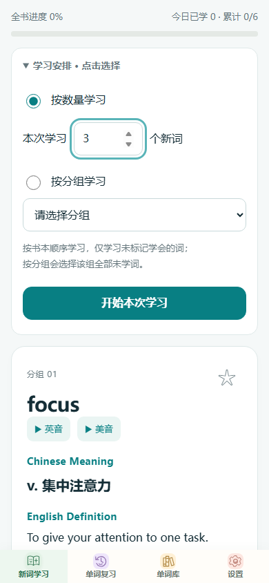
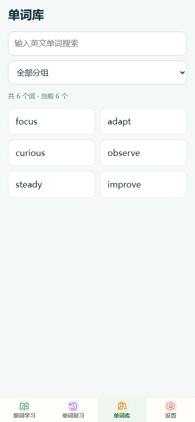
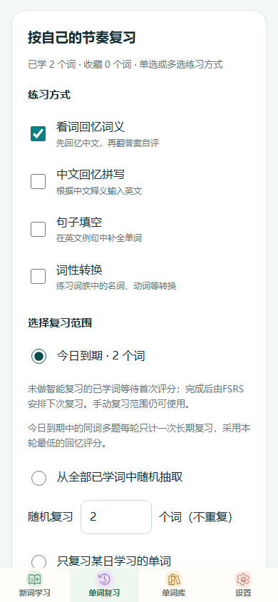
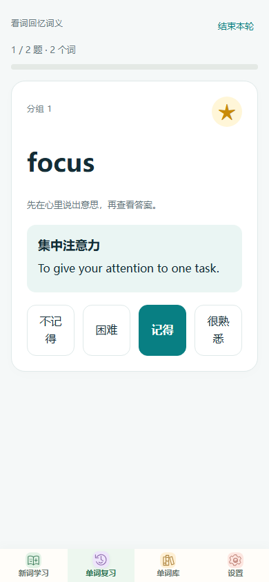
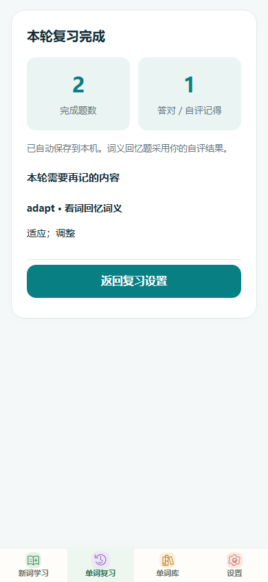
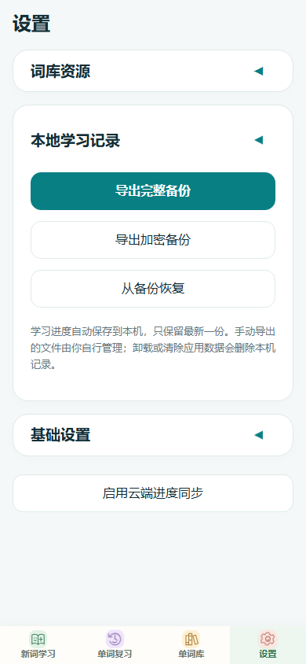

# Memorize Words / 词记

本地优先的单词学习工具：词库与学习记录保存在本机，提供安卓应用和网页版，用 FSRS 安排到期复习。可选自部署云端，只在点击"同步进度"时同步学习记录、评分与收藏。

截图来自[在线使用](https://wang189327-wq.github.io/memorize-words/)页面，使用自带的6张原创示例词卡，不含任何真实学习数据。

仓库：[memorize-words](https://github.com/wang189327-wq/memorize-words)。

| 新词学习                                   | 单词库与筛选                                 | 复习范围与练习方式                      |
| ------------------------------------------ | -------------------------------------------- | --------------------------------------- |
|  |  |  |

| 作答后四档评分                                         | 本轮复习结果                                         | 本地备份与加密                        |
| ------------------------------------------------------ | ---------------------------------------------------- | ------------------------------------- |
|  |  |  |

## 为什么做这个

多数背单词软件按它们内置的词书组织学习：什么时候复习、复习哪些词由平台决定，换设备要迁就它的账号体系，想把自己整理的词放进它的复习流程往往没有入口。

自学者手里的材料恰恰是自己的：一本书、一份词表、边读边攒下的生词。这类学习需要的是一处自己完全掌控的记录——词自己录，进度在本机，复习调度透明可复现。Memorize Words 按这个前提设计：本地存储是默认形态，云同步是可选项，词库内容不经过任何第三方服务器。

## 能做什么

- 新词学习：按数量或分组选择，按词库顺序学习；7词、18词和结束时拼写巩固。
- 今日到期：FSRS按四档反馈（不记得/困难/记得/很熟悉）安排间隔复习；同词多题每轮只计一次，保留手动选词。
- 单词复习：词义回忆、中文回忆拼写、句子填空、词形转换，可组合选择。
- 收藏：单击星标，随机抽取收藏词，或输入起止范围按词库顺序复习。
- 单词库：英文搜索、分组筛选、左右切换词卡；当日单词可带序号与释义复制。
- 备份：明文或密码加密导出与恢复（PBKDF2 + AES-GCM），含完整学习记录。
- 网页离线：首次联网完成缓存后可断网重开；更新失败保留旧缓存，学习数据留在 IndexedDB。
- 设置：字号、背景色、可选手动云同步。
- Android：调用系统离线语音，英音美音分开请求；缺少某个口音时明确提示，不用另一个口音代替。
- 更新：应用内下载、SHA256校验、系统确认安装，成功更新后清理APK缓存。

## 使用范围与边界

**适用：**自己录入词库的学习者。公开版只带6张原创示例词卡，词库通过"设置→词库资源→导入本地词库"添加，格式见[数据说明](docs/data-format.md)。

**不内置词书、不做OCR是有意设计。**仓库不含任何商业词书内容；软件不识别PDF、图片或EPUB。

**当前只维护一本活动词库。**切换到另一本前，应导出需要保留的完整备份；恢复完整备份会替换当前词库及记录。

**云同步是单所有者自部署。**一套后端只注册一个账号，供该账号的多台设备手动同步；不存在项目方提供的公共账号服务。评分同步需部署1.5后端。

## 下载安装

[最新发布](https://github.com/wang189327-wq/memorize-words/releases/tag/v1.1-code2) 提供 APK 与源码：

| 内容                     | 用途           |
| ------------------------ | -------------- |
| `memorize-words-1.1.apk` | 安卓客户端     |
| 源码（对应 tag 的 ZIP）  | 自行构建、修改 |

APK 只带6张示例词卡，**不包含任何云端地址或账号**——仅本地使用不需要任何服务器；需要多设备同步时按下文自部署。

当前显示版本 1.1 / versionCode 2，应用ID `cn.ielts75.app`，与作者个人版同包名、不能并存。1.0/code1 可同签名覆盖升级；旧 code25 等较高版本码应先导出完整备份，再卸载、安装并恢复。此公开版不含个人词书、学习记录或签名私钥。

## 直接体验

打开[在线使用](https://wang189327-wq.github.io/memorize-words/)即可完整使用：学词、评分、备份都在浏览器里完成。数据保存在当前浏览器的 IndexedDB，建议保持同一网址访问；换浏览器、隐私模式或清理站点数据不会保留原数据。

## 本机先看看

安装 Node.js 22 或更新的受支持版本，在仓库根目录运行：

```sh
npm ci
npm run configure
npm start
```

打开 `http://localhost:8080`。导入自己的词库即可正常学习；本地运行不连接任何云端。

## 自部署同步

需要把学习进度同步到多台设备时，按顺序阅读：

1. [自部署同步后端](docs/cloud.md)：Node 服务、Tablestore、单所有者账号注册与部署步骤。
2. [数据说明](docs/data-format.md)：词库与备份格式、同步冲突合并规则。
3. [发布及更新](docs/releasing.md)：用自己的仓库与签名发布，不覆盖已发布的版本。

同步只在点击"同步进度"时发生，上传的是学习记录、评分与收藏，不上传词书内容。旧后端同步评分时会明确提示评分尚未同步，本地保留日志。

## 常见问题

**装不上 APK，或提示签名冲突。**不同签名的 APK 不能互相覆盖安装。先导出完整备份，再卸载重装；卸载只清掉本机数据，云端记录（如有）不受影响。

**装了新版，学习数据不见。**应用ID沿用 `cn.ielts75.app` 且版本码已重置；旧 code25 等较高版本码的包应先导出完整备份，再卸载、安装新版并恢复备份。

**加密备份的密码忘了。**密码不保存、不上传，无法找回；只能改用导出时的明文备份，或重新学习。明文文件上限30MiB、加密原文上限20MiB。

**网页离线打不开。**首次访问需联网完成缓存；此后更新失败会保留旧缓存继续可用，学习数据始终在本机 IndexedDB。

**能不能多人或多本词库同时用。**当前不支持。后端只有单所有者账号，本机只有一本活动词库；这类需求应改用带账号与多词库隔离的系统。

**为什么没有词书。**公开版有意不包含商业词书，也不提供 PDF/OCR/EPUB 导入；词库由使用者自己按[数据格式](docs/data-format.md)录入或生成。

## 构建与检查

```sh
npx playwright install chromium
npm run format:check
npm run lint
npm run check:config
npm run check:generated
npm run check:public
npm test
```

`npm test` 运行核心规则、HTTP 后端和真实 IndexedDB 浏览器测试；不连接真实阿里云，不安装手机软件，不生成测试截图。

安卓构建需要 JDK 21、Android SDK Platform 35 与 Build Tools 35.0.0，先执行 `npm ci` 并设置 `JAVA_HOME`、`ANDROID_HOME`：

```powershell
.\gradlew.bat clean assembleDebug testDebugUnitTest
```

输出位于 `android/app/build/outputs/apk/debug/app-debug.apk`（调试签名包，正式发布需自己的签名）。详细步骤与 macOS/Linux 命令见[构建说明](docs/build.md)。Windows 中文目录导致测试类无法加载时，用 Python 3.12+ 执行 `python tools/build-android.py`。

GitHub Actions 运行源码检查、双端测试与页面部署；CI 不部署你的服务器，也不使用签名或云端凭据。

## 目录

```
memorize-words/
├── web/                     网页版与安卓共用的前端
│   ├── core.js              词库与备份校验、学习队列等纯规则
│   ├── domain/              FSRS调度、评分事件契约、加密备份、7/18巩固
│   ├── ui/                  页面模块与唯一持久化入口 persist
│   ├── storage/             IndexedDB记录事务
│   ├── vendor/              ts-fsrs 6.0.0，附来源与SHA256
│   └── sw.js / offline.js   网页离线缓存
├── android/                 WebView外壳、原生存储、语音、更新
├── cloud/                   自部署同步后端（HTTP接口与Tablestore）
├── tests/                   单元测试与真实IndexedDB浏览器测试
├── tools/                   配置生成、公开检查、构建辅助
├── docs/                    架构、数据格式、部署与构建文档
└── local-delivery/          本地交付打包（不进Git）
```

## 第一次阅读源码

前端没有框架与打包器：页面用 ES 模块，业务规则、存储与平台接口分目录维护。建议按这个顺序熟悉：

1. 从[架构与修改入口](docs/architecture.md)的职责表入手，再读 `web/core.js`——全部纯规则，可被 Node 测试直接加载。
2. 复习调度沿 `web/domain/scheduler.js`（FSRS）与 `rating-contract.js`（评分事件契约）读；评分以不可变事件存储，调度状态可确定性重放。
3. 界面改动读 `web/ui/` 对应页面模块；所有持久化必须经过 `web/ui/state.js` 的 `persist`，不要绕过它直接修改状态或写数据库。
4. 平台差异看 `web/browser-store.js` 与 `android/` 的 `LearningStorage.java`；Android 通过 `window.AndroidStore` 桥接，不读取 ES 模块内部变量。

安卓资源与网页由同一份源码生成，应用名称、包名、版本与更新渠道统一从 [app.config.json](app.config.json) 读取，改动后运行 `npm run configure`。

## 升级与兼容

1.0/code1 可同签名覆盖升级到 1.1/code2。新版能读旧 schema 1 备份，新导出使用 schema 2 封装，旧程序不承诺读取新备份。历史已有 1.1 标签，本轮使用 `v1.1-code2` 保留旧发布。

应用ID仍为 `cn.ielts75.app`，与个人版同包名、不能并存；部分本地存储键与后端环境变量保留历史 `ielts75` 前缀，以避免不必要的数据迁移，它们不是访问个人服务器的配置。评分同步需 1.5 后端，旧后端保留本地评分日志。

## 参与改进

当前比功能建议更有用的三类帮助：

1. **实体设备反馈**——CI 覆盖源码检查与双端测试，真机验收仍在进行，见[验证记录](docs/verification.md)。遇到语音、WebView 或安装差异请附机型与系统版本。
2. **词库格式实践**——用自己的词表走一遍导入流程，格式走不通、报错不清楚的地方，直接提 Issue 并附脱敏样例。
3. **文档纠错**——部署与构建步骤里走不通、说不清的地方，说明卡在第几步、报什么错。

修改代码请先读[贡献指南](CONTRIBUTING.md)与[架构说明](docs/architecture.md)。Fork 须关闭更新检查，或填写自己的应用ID、发布地址并使用自己的签名。

## 数据与授权

词库与学习记录保存在本机；自部署云同步只在手动触发时上传学习记录、评分与收藏，不上传词书内容。备份文件由使用者自行保管，加密备份的密码遗失无法恢复。

项目代码及原创示例使用 [MIT 许可](LICENSE)。ts-fsrs 等第三方工具保留各自许可证，见[第三方说明](THIRD_PARTY_NOTICES.md)。报告问题前请阅读[安全与数据边界](SECURITY.md)，不要在 Issue 中粘贴词书内容或真实学习记录。
