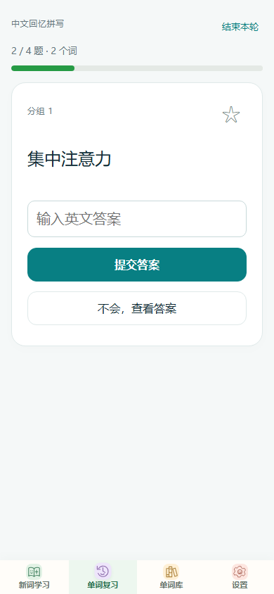
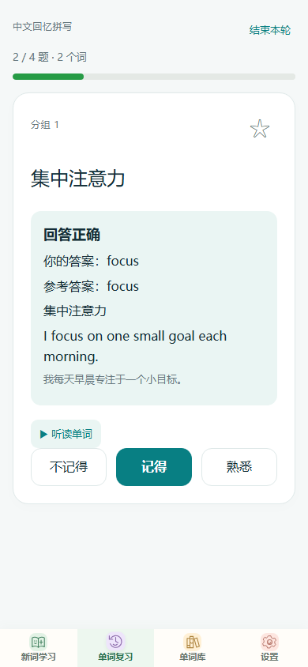

<h1 align="center">Memorize Words / 词记</h1>

<p align="center">
  <a href="https://github.com/wang189327-wq/memorize-words/actions/workflows/ci.yml"></a>
  <a href="package.json"></a>
  <a href="LICENSE"></a>
  <a href="https://github.com/wang189327-wq/memorize-words/releases/latest"></a>
  <a href="https://wang189327-wq.github.io/memorize-words/"></a>
</p>

本地优先的单词学习工具：词库与学习记录保存在本机，提供安卓应用和网页版，用 FSRS 安排到期复习。可选自部署云端，只在点击"同步进度"时同步学习记录、评分与收藏。

截图使用自带的6张原创示例词卡和演示进度。

| 新词学习                                   | 单词库与筛选                                 | 复习范围与练习方式                      | 自评模式：作答后记忆评分                               |
| ------------------------------------------ | -------------------------------------------- | --------------------------------------- | ------------------------------------------------------ |
|  |  |  |  |

| 自动判分：拼写题作答                                     | 自动判分结果与记忆评分                               | 本轮复习结果                                         | 本地备份与加密                        |
| -------------------------------------------------------- | ---------------------------------------------------- | ---------------------------------------------------- | ------------------------------------- |
|  |  |  |  |

## 为什么做这个

我希望按自己整理的词表学习，在本机保存进度，也能知道复习时间是怎样安排的。因此做了词记：词库由自己准备，用FSRS安排到期复习，需要换设备时再手动同步。

## 能做什么

- 新词学习：按数量或分组选择，按词库顺序学习；7词、18词和结束时拼写巩固。
- 今日到期：FSRS按三档反馈（不记得/记得/熟悉）安排间隔复习；同词多题每轮只计一次，保留手动选词。
- 单词复习：词义回忆、中文回忆拼写、句子填空、词形转换，可组合选择。
- 收藏：单击星标，随机抽取收藏词，或输入起止范围按词库顺序复习。
- 单词库：英文搜索、分组筛选、左右切换词卡；当日单词可带序号与释义复制。
- 备份：明文或密码加密导出与恢复（PBKDF2 + AES-GCM），含完整学习记录。
- 网页离线：首次联网完成缓存后可断网重开；更新失败保留旧缓存，学习数据留在 IndexedDB。
- 设置：字号、背景色、可选手动云同步。
- Android：调用系统离线语音，英音美音分开请求；缺少某个口音时明确提示，不用另一个口音代替。
- 更新：应用内下载、SHA256校验、系统确认安装，成功更新后清理APK缓存。

## 使用范围与边界

适合愿意自己整理词库的学习者。公开版带6张原创示例词卡，可先体验完整学习流程，再按下方步骤导入自己的词表。准备词库需要编辑JSON文件，目前没有可视化录入工具，也不识别PDF、图片或EPUB。

当前只维护一本活动词库。导入不同词库或恢复完整备份会替换当前词库及记录，操作前请导出需要保留的完整备份。

云同步需要自部署后端：一套后端只注册一个账号，供该账号的多台设备使用；项目不提供公共账号服务。

## 下载安装

从[最新发布](https://github.com/wang189327-wq/memorize-words/releases/latest)下载。当前版本为1.1.1 / versionCode 3。

| 文件                              | 用途                 |
| --------------------------------- | -------------------- |
| `memorize-words-1.1.1.apk`        | 安卓客户端           |
| `memorize-words-1.1.1-source.zip` | 对应发布版本的源码   |
| `memorize-words-1.1.1-web.zip`    | 网页部署包           |
| `wordmemo-sync-1.5.0.zip`         | 可选的自部署同步后端 |

只在本机学习时，安装APK即可，不需要账号或服务器。公开包不预设云端地址。覆盖安装、签名冲突和旧版本迁移见下方“升级与兼容”。

## 直接体验

打开[网页版](https://wang189327-wq.github.io/memorize-words/)，可使用示例词库学习、复习及导出备份。数据保存在当前浏览器；换浏览器、使用隐私模式或清理站点数据，都可能无法继续使用原记录。

### 导入自己的词库

1. 打开[示例词库JSON](web/deck.json)，在GitHub文件页选择“Download raw file”下载，保存为 `my-words.json`。请使用普通文本编辑器，保留 `.json` 后缀，不要用Word保存。
2. 先保留一张词卡练习修改：将 `bookId` 改为自己的标识（如 `my-words`），修改 `title`，保留 `schemaVersion`。在 `cards` 中保留一张完整卡片，修改单词、词性、释义、英文解释、例句及中文翻译，搭配也应改为对应内容；不使用的 `cloze`、`conversion` 与 `supplementary` 可删除，避免练习答案仍是旧单词。
3. 复制这张卡片添加其他单词。每张卡的 `id`、`word` 和正整数 `order` 必须唯一；按想学习的顺序设置 `order`，用 `source.sentence` 设置分组。字段说明及限制见[数据格式](docs/data-format.md)。
4. 在软件中打开“设置→词库资源→导入本地词库”，选择JSON文件并确认。导入后先检查几张卡片和练习题，再开始学习；如果失败，按界面提示检查字段或JSON语法。

以后更新同一词库时，保持 `bookId` 和已有词条的 `id` 不变，软件会合并词卡并保留学习日期。完整学习记录应通过“导出备份”保存，单独的词库JSON不含学习进度。

## 本机先看看

安装 Node.js 22 或更新的受支持版本，在仓库根目录运行：

```sh
npm ci
npm run configure
npm start
```

打开 `http://localhost:8080`。导入自己的词库即可正常学习；本地运行不连接任何云端。

## 自部署同步

需要把学习进度同步到多台设备时，按顺序阅读：

1. [自部署同步后端](docs/cloud.md)：Node 服务、Tablestore、单所有者账号注册与部署步骤。
2. [数据说明](docs/data-format.md)：词库与备份格式、同步冲突合并规则。
3. [发布及更新](docs/releasing.md)：用自己的仓库与签名发布，不覆盖已发布的版本。

同步只在点击"同步进度"时发生，上传的是学习记录、评分与收藏，不上传词书内容。旧后端同步评分时会明确提示评分尚未同步，本地保留日志。

## 常见问题

**装不上APK，或提示签名冲突？** 同签名更新和旧包处理见下方“升级与兼容”。更换签名需要先导出备份、卸载旧应用，再安装并恢复；卸载会清除本机数据，不删除云端记录。

**加密备份密码忘了？** 密码不保存，无法找回。只有此前另行导出的明文备份可用于恢复。明文文件上限30MiB、加密原文上限20MiB。

**网页离线打不开？** 首次访问需联网完成缓存，之后才能断网重开。缓存更新失败会保留旧版本，浏览器清理站点数据仍可能删除缓存和学习记录。

**能否多人或多本词库同时用？** 当前不支持。本机只有一本活动词库，自部署后端只支持单所有者账号。

**能直接导入电子书吗？** 目前只接受规定格式的词库JSON或完整备份。电子书需要先自行整理成词卡，软件不提供识别或转换工具。

## 构建与检查

```sh
npx playwright install chromium
npm run format:check
npm run lint
npm run check:config
npm run check:generated
npm run check:public
npm test
```

`npm test` 运行核心规则、HTTP 后端和真实 IndexedDB 浏览器测试；不连接真实阿里云，不安装手机软件，不生成测试截图。

安卓构建需要 JDK 21、Android SDK Platform 35 与 Build Tools 35.0.0，先执行 `npm ci` 并设置 `JAVA_HOME`、`ANDROID_HOME`：

```powershell
.\gradlew.bat clean assembleDebug testDebugUnitTest
```

输出位于 `android/app/build/outputs/apk/debug/app-debug.apk`（调试签名包，正式发布需自己的签名）。详细步骤与 macOS/Linux 命令见[构建说明](docs/build.md)。Windows 中文目录导致测试类无法加载时，用 Python 3.12+ 执行 `python tools/build-android.py`。

GitHub Actions 运行源码检查、双端测试与页面部署；CI 不部署你的服务器，也不使用签名或云端凭据。

## 目录

```
memorize-words/
├── web/                     网页版与安卓共用的前端
│   ├── core.js              词库与备份校验、学习队列等纯规则
│   ├── domain/              FSRS调度、评分事件契约、加密备份、7/18巩固
│   ├── ui/                  页面模块与唯一持久化入口 persist
│   ├── storage/             IndexedDB记录事务
│   ├── vendor/              ts-fsrs 6.0.0，附来源与SHA256
│   └── sw.js / offline.js   网页离线缓存
├── android/                 WebView外壳、原生存储、语音、更新
├── cloud/                   自部署同步后端（HTTP接口与Tablestore）
├── tests/                   单元测试与真实IndexedDB浏览器测试
├── tools/                   配置生成、公开检查、构建辅助
├── docs/                    架构、数据格式、部署与构建文档
└── local-delivery/          本地交付打包（不进Git）
```

## 第一次阅读源码

前端没有框架与打包器：页面用 ES 模块，业务规则、存储与平台接口分目录维护。建议按这个顺序熟悉：

1. 从[架构与修改入口](docs/architecture.md)的职责表入手，再读 `web/core.js`——全部纯规则，可被 Node 测试直接加载。
2. 复习调度沿 `web/domain/scheduler.js`（FSRS）与 `rating-contract.js`（评分事件契约）读；评分以不可变事件存储，调度状态可确定性重放。
3. 界面改动读 `web/ui/` 对应页面模块；所有持久化必须经过 `web/ui/state.js` 的 `persist`，不要绕过它直接修改状态或写数据库。
4. 平台差异看 `web/browser-store.js` 与 `android/` 的 `LearningStorage.java`；Android 通过 `window.AndroidStore` 桥接，不读取 ES 模块内部变量。

安卓资源与网页由同一份源码生成，应用名称、包名、版本与更新渠道统一从 [app.config.json](app.config.json) 读取，改动后运行 `npm run configure`。

## 升级与兼容

应用ID为 `cn.ielts75.app`，与作者个人版相同，两者不能并存。同签名的1.0/code1、1.1/code2可覆盖升级到1.1.1/code3，保留本机记录；升级前建议导出完整备份。

旧code25等版本码高于3的安装包不能直接覆盖降级，需要先导出完整备份，再卸载、安装新版并恢复。卸载前请确认备份已经保存。

新版可读取旧schema 1备份，当前导出使用schema 2，旧程序不保证能读取。历史Release保留对应源码与安装包。

部分存储键和后端环境变量保留 `ielts75` 前缀，以兼容旧数据。评分同步需要1.5后端；旧后端无法同步评分时会提示，本地评分日志保留。

## 参与改进

欢迎提交设备兼容、词库导入和文档问题。遇到错误时，请说明操作步骤、报错内容、软件版本；设备问题请附机型与系统版本，词库问题可附脱敏后的最小样例。

本次发布尚未完成实体安卓验收，已完成的验证见[验证记录](docs/verification.md)。浏览器和电脑模拟结果不代表真机表现。

修改代码前可阅读[贡献指南](CONTRIBUTING.md)与[架构说明](docs/architecture.md)。Fork须关闭更新检查，或填写自己的应用ID、发布地址并使用自己的签名。

## 数据与授权

词库及备份文件由使用者自行保管。仓库不附带商业词书；请仅导入有权使用的材料，不要在公开反馈中上传个人词库或学习记录。

项目代码及原创示例使用 [MIT 许可](LICENSE)。ts-fsrs 等第三方工具保留各自许可证，见[第三方说明](THIRD_PARTY_NOTICES.md)。报告问题前请阅读[安全与数据边界](SECURITY.md)，不要在 Issue 中粘贴词书内容或真实学习记录。
